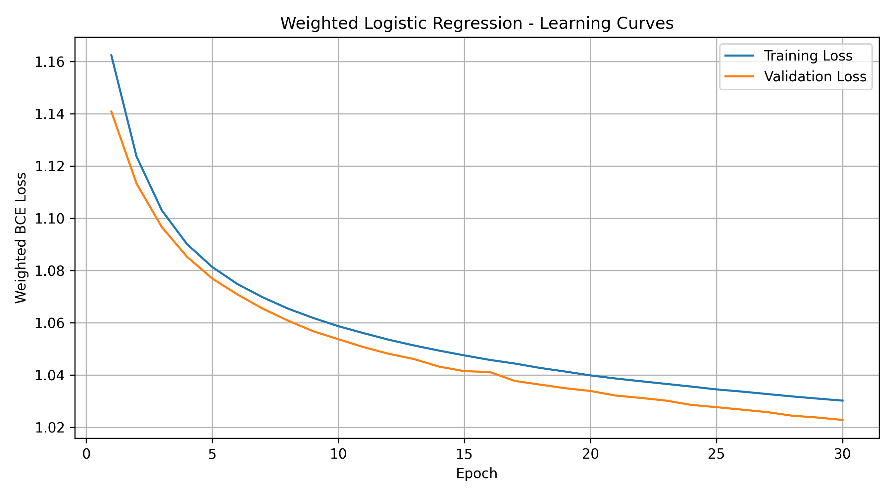
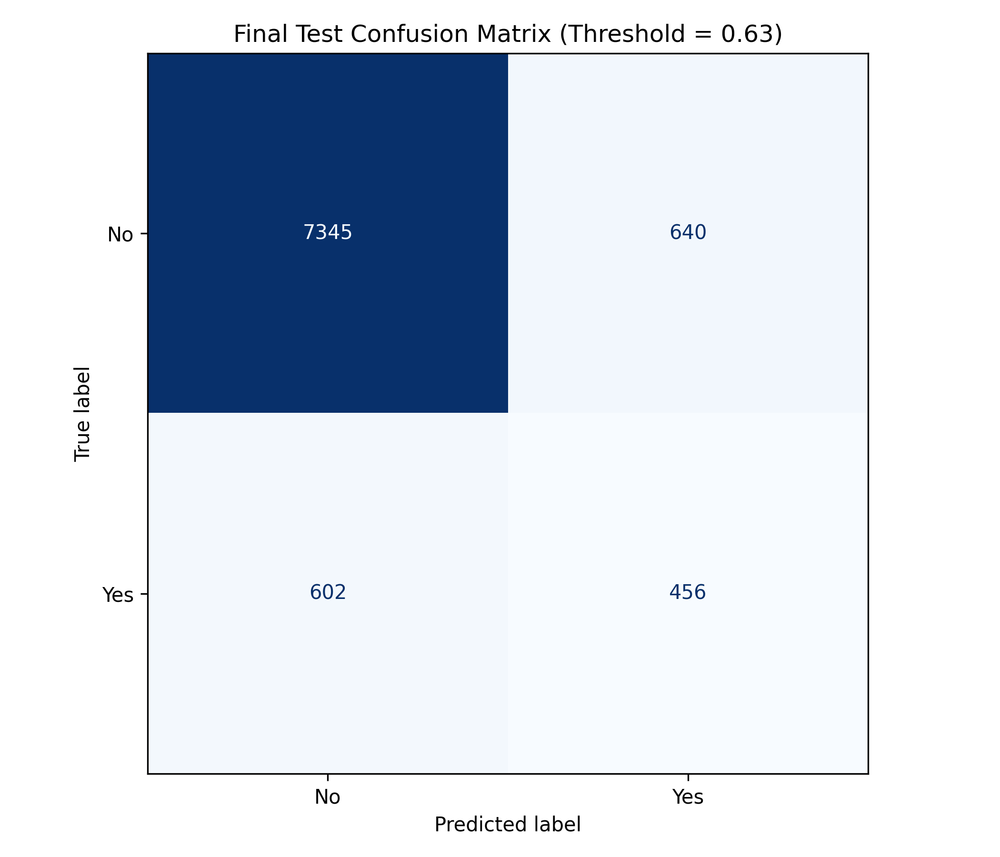
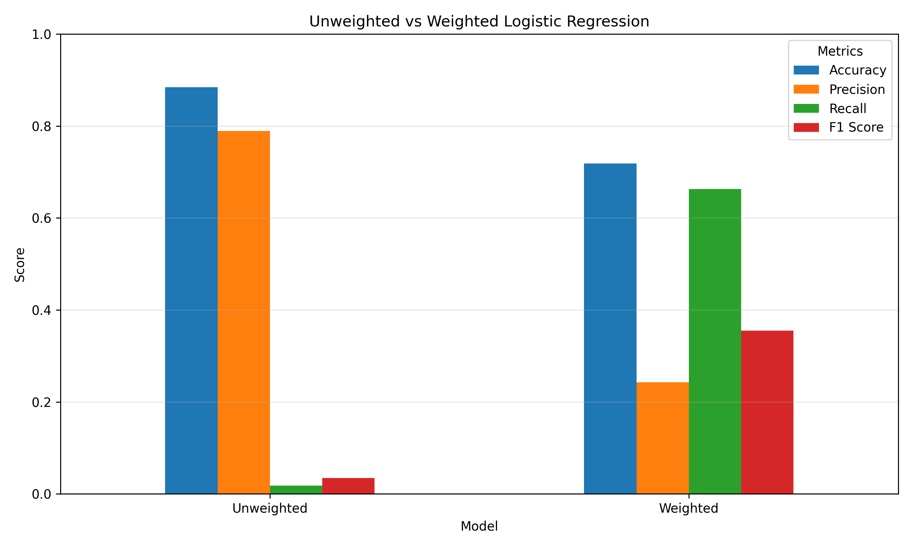
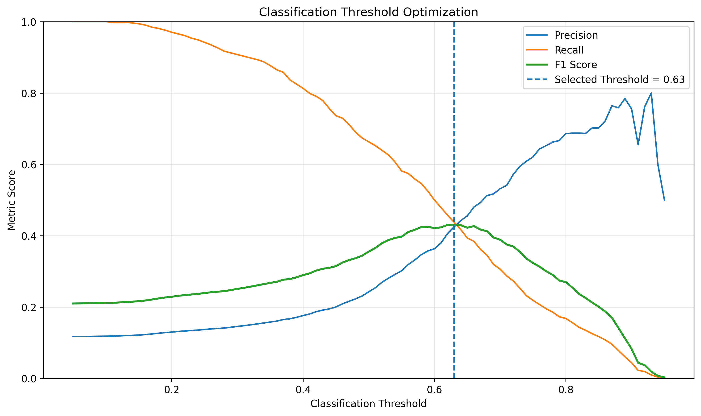

# Bank Marketing Subscription Prediction Using PyTorch

A Machine Learning classification project that predicts whether a bank customer will subscribe to a term deposit based on their demographic and previous campaign information.

The project explores Logistic Regression implemented using a custom PyTorch model, including data preprocessing, model training, gradient descent, class imbalance handling, threshold tuning, and model evaluation.

## Project Overview

Bank marketing campaigns require resources to contact potential customers. The objective of this project is to build a binary classification model that identifies customers who are more likely to subscribe to a term deposit.

**Problem type:** Binary Classification

**Algorithm:** Logistic Regression

**Deep Learning Framework:** PyTorch

**Dataset:** UCI Bank Marketing Dataset

**Target variable:** `y` (yes / no)

## Dataset

The project uses the Bank Marketing dataset from the UCI Machine Learning Repository.

- Total records: 45,211
- Original features: 16
- Target variable: 1
- Target classes: yes / no

Dataset source: [UCI Bank Marketing Dataset](https://archive.ics.uci.edu/dataset/222/bank+marketing)

The dataset contains customer demographic information, account details, and previous marketing campaign information.

## Technologies and Libraries

- Python
- PyTorch
- NumPy
- Pandas
- Scikit-learn
- Matplotlib
- SciPy
- Google Colab

## Project Workflow

### 1. Data Understanding and Exploration

- Dataset inspection and structural analysis.
- Data type identification.
- Missing value and duplicate detection.
- Investigation of unknown categorical values.
- Statistical summaries of numerical features.
- Outlier investigation.
- Data validation and consistency checks.

### 2. Data Cleaning and Preparation

- Preserved unknown categorical values.
- Investigated extreme numerical values instead of removing them automatically.
- Checked zero-duration records.
- Created a separate target variable.
- Excluded the `duration` feature to prevent data leakage.

**Important:** Call duration is only known after a marketing call. Since this project aims to predict subscription before the call, using duration would introduce information that would not be available at prediction time.

### 3. Exploratory Data Analysis

The target variable is imbalanced:

| Customer outcome | Percentage |
|---|---:|
| No subscription | 88.3% |
| Subscription | 11.7% |

This imbalance makes accuracy alone an unreliable measure of model performance.

### 4. Data Preprocessing

Numerical features:
- StandardScaler

Categorical features:
- OneHotEncoder
- `handle_unknown="ignore"`

A ColumnTransformer combines both preprocessing operations.

The preprocessor is fitted only on training data. Validation and test data are transformed using the same fitted preprocessor to prevent data leakage.

After encoding, the dataset contains 50 input features.

### 5. Model Development Using PyTorch

Logistic Regression was implemented using a custom PyTorch model.

The mathematical formulation is:

**Linear transformation**

`z = Xw + b`

**Sigmoid activation**

`p = 1 / (1 + exp(-z))`

The output represents the estimated probability of a customer subscribing.

The model contains:
- 50 trainable weights
- 1 trainable bias
- 51 total trainable parameters

### 6. Model Training

The model was trained using:

- Optimizer: Stochastic Gradient Descent (SGD)
- Learning rate: 0.01
- Batch size: 256
- Initial training epochs: 30
- Loss function: Binary Cross-Entropy

The training process uses PyTorch operations:

- `optimizer.zero_grad()`
- Forward propagation
- Loss calculation
- `loss.backward()`
- `optimizer.step()`

### 7. Handling Class Imbalance

Two approaches were investigated.

**Unweighted Logistic Regression**

Used ordinary `BCEWithLogitsLoss()`.

**Weighted Logistic Regression**

Used `BCEWithLogitsLoss(pos_weight=7.5477)` to give greater importance to the minority class (`yes`).

The weighted model substantially improved subscriber recall on validation data.

### 8. Threshold Optimization

Instead of relying exclusively on the default classification threshold of 0.5, different thresholds were evaluated using validation data.

Thresholds between 0.05 and 0.95 were investigated.

The best validation F1-score was obtained at:

- Selected threshold: 0.65
- Validation precision: 45.66%
- Validation recall: 41.02%
- Validation F1-score: 0.4321

The selected threshold was then applied to the untouched test dataset.

## Final Model Evaluation

**Final model:** Weighted Logistic Regression using PyTorch

**Selected classification threshold:** 0.63

### Test Performance

| Metric | Result |
|---|---:|
| Accuracy | 86.27% |
| Precision (yes) | 41.61% |
| Recall (yes) | 43.10% |
| F1-score (yes) | 42.34% |

### Confusion Matrix

| | Predicted No | Predicted Yes |
|---|---:|---:|
| Actual No | 7,345 | 640 |
| Actual Yes | 602 | 456 |

The model correctly identified 456 out of 1,058 actual subscribers.

### Project Visualizations

**1. Training and Validation Learning Curves**
### 1. Training and Validation Learning Curves


### 2. Final Test Confusion Matrix


### 3. Weighted vs Unweighted Model Comparison


### 4. Classification Threshold Optimization



## Key Learnings

Through this project, I practiced:

- Building a Machine Learning pipeline.
- Data cleaning and exploratory data analysis.
- Feature engineering and preprocessing.
- Implementing Logistic Regression using PyTorch.
- Understanding weights, bias and sigmoid activation.
- Understanding Binary Cross-Entropy.
- Implementing Gradient Descent using SGD.
- Automatic differentiation and backpropagation.
- Mini-batch training with DataLoader.
- Handling class imbalance with weighted loss.
- Precision, Recall, F1-score and Confusion Matrix.
- Decision threshold optimization.
- Avoiding data leakage.
- Evaluating models on unseen data.

## Project Structure

```text
Bank-Marketing-Subscription-Prediction/
│
├── README.md
├── requirements.txt
├── .gitignore
│
├── notebooks/
│   └── Bank_Marketing_ML_Engineering.ipynb
│
├── models/
│   ├── README.md
│   └── weighted_model.pth
│
├── reports/
│   ├── README.md
│   ├── learning_curves.png
│   ├── confusion_matrix.png
│   ├── model_comparison.png
│   └── threshold_tuning.png
│
└── data/
    └── README.md
```

## Limitations and Future Improvements

- Experiment with Adam and other optimizers.
- Investigate alternative classification algorithms.
- Explore regularization techniques.
- Evaluate probability calibration.
- Compare ROC-AUC and Precision-Recall AUC.
- Investigate different class weighting strategies.
- Develop a reusable inference pipeline.

## Author

**Muhammad Ali Rehman**

BS Computer Science Student

GitHub: [Malirehman](https://github.com/Malirehman)

---

*This project was developed in Google Colab as part of practical Machine Learning and PyTorch learning.*
